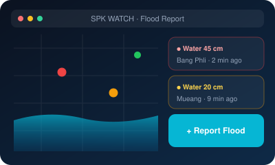
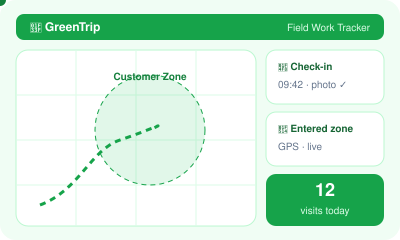
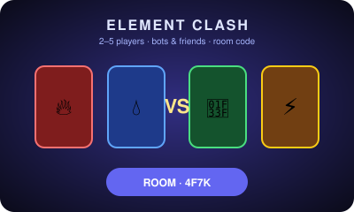
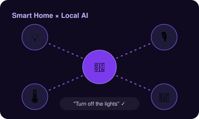
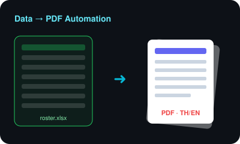

---

## 👋 About Me · เกี่ยวกับฉัน

<table>
<tr>
<td width="50%" valign="top">

**🇬🇧 English**

I'm **THIRD**, a Computer Science student from Thailand 🇹🇭 who loves turning ideas into working software — from flood-reporting apps to multiplayer card games.

- 🌐 Full-Stack Web Development
- 🤖 AI & Automation
- 🎨 UI/UX Design
- 🧩 Game & Interactive Web

</td>
<td width="50%" valign="top">

**🇹🇭 ภาษาไทย**

สวัสดีครับ/ค่ะ ฉันชื่อ **THIRD** นักศึกษาวิทยาการคอมพิวเตอร์ ชอบเปลี่ยนไอเดียให้กลายเป็นซอฟต์แวร์ที่ใช้งานได้จริง ตั้งแต่เว็บรายงานน้ำท่วมไปจนถึงเกมการ์ดออนไลน์

- 🌐 พัฒนาเว็บแบบ Full-Stack
- 🤖 AI และระบบอัตโนมัติ
- 🎨 ออกแบบ UI/UX
- 🧩 เกมและเว็บแบบอินเทอร์แอกทีฟ

</td>
</tr>
</table>

---

## 🛠️ Tech Stack · เครื่องมือที่ใช้

  
  

---

## 🚀 Projects · ผลงาน

<table>
<tr>
<td width="50%" valign="top" align="center">

### 🌊 SPK WATCH
</td>
<td width="50%" valign="top">

**🇬🇧** Community flood-reporting web app for Samut Prakan — pin flood spots on a map, report water levels, and follow the situation live.

**🇹🇭** เว็บแอปให้ชาวสมุทรปราการรายงานน้ำท่วม ปักหมุดจุดน้ำท่วมบนแผนที่ แจ้งระดับน้ำ และติดตามสถานการณ์แบบเรียลไทม์

`📍 Map` `📝 Community Reports` `📱 Mobile-first`

</td>
</tr>
<tr>
<td width="50%" valign="top">

**🇬🇧** Field-staff tracking system — geofenced customer zones, live GPS, photo check-ins and zone alerts for teams working outside the office.

**🇹🇭** ระบบติดตามพนักงานภาคสนาม กำหนดโซนลูกค้า (Geofence) ติดตาม GPS เช็กอินพร้อมรูปถ่าย และแจ้งเตือนเมื่อเข้า-ออกโซน

`🗺️ Geofencing` `📍 GPS` `📸 Check-in` `🔔 Alerts`

</td>
<td width="50%" valign="top" align="center">

### 🌿 GreenTrip
</td>
</tr>
<tr>
<td width="50%" valign="top" align="center">

### ⚔️ ธาตุปะทะ · Element Clash
</td>
<td width="50%" valign="top">

**🇬🇧** Real-time multiplayer web card game for 2–5 players. Join by room code — no login — play with friends or add bots, with flashy elemental effects.

**🇹🇭** เกมการ์ดออนไลน์เล่นได้ 2–5 คน เข้าห้องด้วยรหัส ไม่ต้องล็อกอิน เล่นกับเพื่อนหรือเพิ่มบอทได้ พร้อมเอฟเฟกต์ธาตุจัดเต็ม

`🎮 Multiplayer` `🤖 Bots` `🔑 Room Code`

</td>
</tr>
<tr>
<td width="50%" valign="top">

**🇬🇧** Personal experiments connecting smart-home devices with local AI — voice commands, automations and API integrations.

**🇹🇭** การทดลองเชื่อมอุปกรณ์สมาร์ตโฮมเข้ากับ AI ที่รันในเครื่อง สั่งงานด้วยเสียง ทำระบบอัตโนมัติ และเชื่อมต่อ API

`💡 IoT` `🎙️ Voice` `🔗 Automation`

</td>
<td width="50%" valign="top" align="center">

### 🏠 Smart Home × AI
</td>
</tr>
<tr>
<td width="50%" valign="top" align="center">

### 📄 Data → PDF Automation
</td>
<td width="50%" valign="top">

**🇬🇧** Scripts that turn spreadsheets into print-ready PDFs — student rosters, sign-in sheets for 130+ students, and game cards — with full Thai font support.

**🇹🇭** สคริปต์แปลงข้อมูลจากสเปรดชีตเป็น PDF พร้อมพิมพ์ เช่น รายชื่อนักศึกษา ใบเซ็นชื่อกว่า 130 คน และการ์ดเกม รองรับฟอนต์ภาษาไทยเต็มรูปแบบ

`📊 Excel` `🖨️ PDF` `🇹🇭 Thai Fonts`

</td>
</tr>
</table>

---

## 📊 GitHub Stats · สถิติ

---

## 🎯 Now · ตอนนี้กำลัง

| 🔭 Exploring · สำรวจ | 🎨 Building · สร้าง | 🧠 Learning · เรียนรู้ |
|:---:|:---:|:---:|
| AI & Automation | Element Clash 🎮 | Computer Architecture & OS |
| Realtime Web | GreenTrip 🌿 | Computer Networks |
| Thai FinTech | Useful Web Tools | Clean Architecture |

---

## 🤝 Let's Connect · มาคุยกัน

  

*"Less noise. More creativity. Better code."* 
*เสียงรบกวนน้อยลง ความคิดสร้างสรรค์มากขึ้น โค้ดที่ดีขึ้น*

