 

---

## 👋 Hey, I'm THIRD

CS student from Thailand 🇹🇭 who just really likes building things. I'll take a random idea and keep hacking on it until it actually works — flood maps, field-tracking apps, multiplayer card games, you name it.

- 🌐 Full-stack web stuff
- 🤖 Messing around with AI & automation
- 🎨 Making UIs that don't look boring
- 🎮 Fun interactive web games

---

## 🛠️ What I use

  
  

---

## 🚀 Stuff I've built

<table>
<tr>
<td width="50%" valign="top" align="center">

### 🌊 SPK WATCH
</td>
<td width="50%" valign="top">

A flood-reporting app for Samut Prakan. People drop a pin, say how deep the water is, and everyone can see what's going on in real time.

`📍 Map` `📝 Reports` `📱 Mobile-first`

</td>
</tr>
<tr>
<td width="50%" valign="top">

An app for teams working out in the field. Set up customer zones on a map, track GPS, check in with a photo, and get pinged when someone enters or leaves a zone.

`🗺️ Geofencing` `📍 GPS` `📸 Check-in` `🔔 Alerts`

</td>
<td width="50%" valign="top" align="center">

### 🌿 GreenTrip
</td>
</tr>
<tr>
<td width="50%" valign="top" align="center">

### ⚔️ Element Clash · ธาตุปะทะ
</td>
<td width="50%" valign="top">

My multiplayer card game! 2–5 players, jump in with a room code (no sign-up), play with friends or throw in some bots. Lots of flashy element effects.

`🎮 Multiplayer` `🤖 Bots` `🔑 Room Code`

</td>
</tr>
<tr>
<td width="50%" valign="top">

Side experiments hooking up smart-home gadgets to AI running locally. Talk to it, it does things. Lights, plugs, automations — the fun stuff.

`💡 IoT` `🎙️ Voice` `🔗 Automation`

</td>
<td width="50%" valign="top" align="center">

### 🏠 Smart Home × AI
</td>
</tr>
<tr>
<td width="50%" valign="top" align="center">

### 📄 Data → PDF Automation
</td>
<td width="50%" valign="top">

Little scripts that turn spreadsheets into print-ready PDFs — rosters, sign-in sheets for 130+ students, game cards — with Thai fonts that actually render properly.

`📊 Excel` `🖨️ PDF` `🇹🇭 Thai Fonts`

</td>
</tr>
</table>

---

## 📊 GitHub stats

---

## 🎯 What I'm up to

| 🔭 Exploring | 🎨 Building | 🧠 Learning |
|:---:|:---:|:---:|
| AI & Automation | Element Clash 🎮 | Computer Architecture & OS |
| Realtime Web | GreenTrip 🌿 | Computer Networks |
| Thai FinTech | Handy web tools | Writing cleaner code |

---

## 🤝 Say hi!

  

*"Less noise. More creativity. Better code."*

